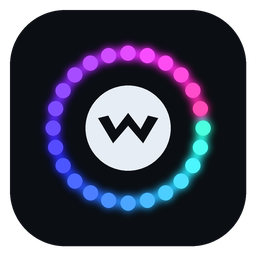

# Cuttlefish

**Free, open-source RGB lighting engine for Windows that runs SignalRGB-format lighting effects and device plugins — plus smartphone camera mapping that places every LED in your case automatically.**

<p align="center"></p>

## Install

Download the latest `Cuttlefish-Setup-x.y.z.exe` from [Releases](https://github.com/Coral-coder/Cuttlefish/releases/latest) and run it. Cuttlefish installs per-user, starts in the tray, and **updates itself silently** whenever a new release is published. You don't need to do anything.

> Windows will ask for administrator rights at launch: Cuttlefish needs them to reach the SMBus for RGB memory (such as Kingston FURY). Close SignalRGB, iCUE, Armoury Crate and other RGB apps first. Two programs driving the same device will fight over it.

## What it does

| Feature | Notes |
|---|---|
| **Lighting effects** | Runs SignalRGB "LightScripts" (HTML pages that draw on a 320×200 canvas, with `<meta>` controls) in an offscreen Chromium. Supports number, hue, boolean, colour, list/combobox and text controls, `on<prop>Changed` callbacks, `engine.audio` (level, density, width, 200-band `freq`), `engine.zone` screen sampling (28×20 HSL) and linear/area vision meters. 12 original built-in effects. |
| **Your existing effect library** | Picks up effects from `Documents\WhirlwindFX\Effects` and an installed SignalRGB automatically, and any folders you add. `Import .html` copies single files in. |
| **Device plugins** | A runtime for SignalRGB-format JavaScript device plugins: HID writes, reads, feature reports, endpoints, `device.color()`, subdevices, component channels (ARGB headers), alerts and messages, user parameters, SMBus `Scan()`/`bus` plugins. On first run, Cuttlefish downloads the public plugin repository ([gitlab.com/signalrgb/signal-plugins](https://gitlab.com/signalrgb/signal-plugins), about 460 devices) and refreshes it weekly. It also loads plugins from a SignalRGB install and `Documents\WhirlwindFX\Plugins`. |
| **OpenRGB bridge** | Optional: drive any device that a running OpenRGB SDK server exposes. |
| **Kingston FURY RGB memory** | A native high-frame-rate driver (see [docs/kingston-fury.md](docs/kingston-fury.md)). |
| **Phone camera mapping** | Cuttlefish hosts a web app (HTTPS on port 7531). Scan the QR code, point your phone at the case, and every LED is located with structured light in about 15 seconds. Devices are then placed, scaled, rotated and mirrored on the canvas so effects flow across the case the way they physically sit. |
| **Layout editor** | Drag, scroll-to-scale, <kbd>R</kbd> rotate, <kbd>F</kbd> mirror, Identify (blink) per device. |
| **Per-device control** | Enable/disable, brightness, plugin settings, ARGB channel LED counts, battery level. |
| **Quality of life** | Tray icon, global brightness and off switch, start with Windows, black-out on sleep, hardware report export. |

## How phone mapping works

1. Every LED gets a number. Cuttlefish lights the LEDs in a sequence of [Gray-code](https://en.wikipedia.org/wiki/Gray_code) patterns, each followed by its inverse (≈2·log₂N frames; 20 frames covers 1,000 LEDs).
2. The phone records each pattern. Per pixel, *pattern brighter than inverse* gives one bit, so every lit pixel decodes the number of the LED it sees. Low-contrast pixels are discarded, and only pixels near each LED's brightest spot are kept, which rejects reflections.
3. The per-LED centroids return to the PC. For each device, a least-squares similarity transform (scale, rotation, translation, with or without mirroring) maps its LED grid onto the observations. LEDs the camera saw get their exact measured position. LEDs it missed are placed by the fitted transform.

`scripts/e2e-mapping.js` exercises the whole loop. It runs the real app with simulated devices and the real phone page with a synthetic camera, and currently locates 70/70 LEDs with 0.5% geometric error.

## Compatibility notes

See [docs/compatibility.md](docs/compatibility.md) for the exact plugin and effect API surface and what is not implemented yet (fan control, OCR meters, network/UDP service plugins, RAWUSB).

## Development

```bash
npm install
npm test               # unit tests (plugin runtime, FURY driver, solver, OpenRGB, effects)
npm start              # run the app
CF_VIRTUAL=1 npm start # run with simulated devices (no hardware needed)
xvfb-run node scripts/e2e-mapping.js   # end-to-end phone-mapping test (needs Playwright)
```

Releases: every push to `main` runs CI. When `package.json` contains a version that has not been released yet, GitHub Actions builds the Windows installer and publishes it as a release. Installed copies then update themselves.

## Legal

Cuttlefish is an independent project. It is not affiliated with WhirlwindFX/SignalRGB, Kingston, or OpenRGB. It ships no SignalRGB code. It implements a compatible runtime from public documentation and type definitions, and fetches the public plugin repository at runtime from its official location. RGB memory access uses the signed [PawnIO](https://pawnio.eu) driver and modules. Cuttlefish blocks plugin writes to SPD EEPROM and thermal-sensor addresses. MIT licensed.
